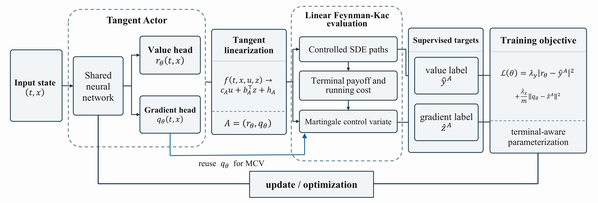

# Tangent-Actor

**Learning to Linearize High-Dimensional Semilinear PDEs**

Tangent-Actor learns a value or gradient field, uses it to linearize the nonlinear PDE driver, and evaluates the resulting linear problem by Feynman–Kac sampling. The learned gradient also serves as a martingale control variate.



## Paper figures and evaluation data

| Evaluation | Paper coverage | Download |
| --- | --- | --- |
| Whole-function accuracy | Eight PDEs, five dimensions, four methods | [RMSE and RelMAE](evaluation/whole_function.csv) |
| Single-point accuracy | Four PDEs, five dimensions, three methods | [RMSE, RelMAE and numerical failure status](evaluation/single_point.csv) |
| Component ablation | Four variants on four 100D PDEs | [Mean RMSE and sample standard deviation](evaluation/component_ablation.csv) |

At the precision printed in the manuscript, Tangent-Actor has the lowest whole-function RMSE in 39 of 40 settings and the lowest single-point RMSE in 20 of 20. [Evaluation notes](evaluation/) describe how the paper tables and historical run summaries were obtained. [All figures](figures/) includes the method diagram, accuracy and ablation plots, solution landscapes and appendix panels.


## Run the code

From a checkout, using Python 3.11 or newer:

```bash
python -m pip install -e ".[test]"
python examples/evaluate_checkpoint.py --checkpoint examples/weights/joint_d4_smoke.pt --sample-states 8
python examples/hjb_log_smoke.py
python examples/joint_smoke.py
python -m pytest -q
```

The [example checkpoint](examples/weights/joint_d4_smoke.pt) is a small 4D coupled nonconvex actor from the CPU training example. The evaluation command loads it and samples new states. To use your own test bank, substitute `--bank /path/to/your_bank.npz`. The file must contain `t` with shape `(n,)` and `x` with shape `(n, dimension)`.

The training examples write checkpoints, predictions and diagnostics to new local directories under `runs/`. See [configuration and input formats](configs/) for custom runs, including OU/GMM and B6, and [algorithm interfaces](docs/ALGORITHM_AND_INTERFACES.md) to extend the method. The public high-dimensional examples use demonstration coefficients. The paper tables report historical evaluations.

## Citation and licenses

If you use the code in research, please cite Yeping Wang, *Tangent-Actor: Learning to Linearize High-Dimensional Semilinear PDEs* (2026 manuscript). [Citation metadata](CITATION.cff).

Original code and the bundled example checkpoint are provided under the [MIT License](LICENSE). Original paper figures are available under [CC BY 4.0](LICENSES/CC-BY-4.0.txt). To reuse or adapt a figure, credit the Tangent-Actor contributors, link to the [license](https://creativecommons.org/licenses/by/4.0/) and identify any changes.
