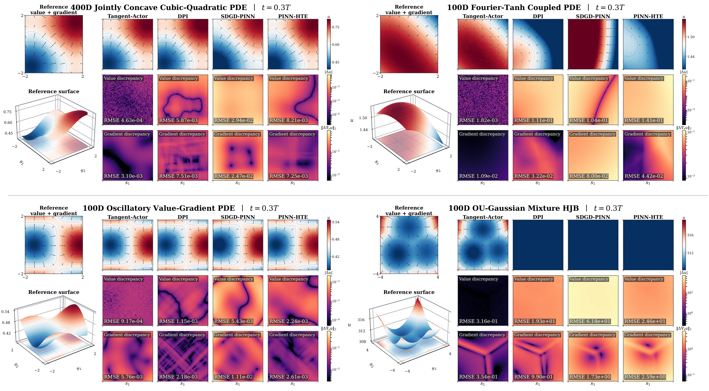

# Tangent-Actor

**Learning to Linearize High-Dimensional Semilinear PDEs**

Tangent-Actor learns a value or gradient field, uses it to linearize the nonlinear PDE driver, and evaluates the resulting linear problem by Feynman–Kac sampling. The learned gradient also serves as a martingale control variate.


## Paper figures and evaluation data

| Evaluation | Paper coverage | Download |
| --- | --- | --- |
| Whole-function accuracy | Eight PDEs, five dimensions, four methods | [RMSE and RelMAE](evaluation/whole_function.csv) |
| Single-point accuracy | Four PDEs, five dimensions, three methods | [RMSE, RelMAE and numerical failure status](evaluation/single_point.csv) |
| Component ablation | Four variants on four 100D PDEs | [Mean RMSE and sample standard deviation](evaluation/component_ablation.csv) |

At the precision printed in the manuscript, Tangent-Actor has the lowest whole-function RMSE in 39 of 40 settings and the lowest single-point RMSE in 20 of 20. [Evaluation notes](evaluation/) describe how the paper tables and historical run summaries were obtained. [All figures](figures/) includes the method diagram, accuracy and ablation plots, solution landscapes and appendix panels.



## Run the code

From a checkout, using Python 3.11 or newer:

```bash
python -m pip install -e ".[test]"
python examples/evaluate_checkpoint.py --checkpoint examples/weights/joint_d4_smoke.pt --sample-states 8
python examples/hjb_log_smoke.py
python examples/joint_smoke.py
python -m pytest -q
```

The [example checkpoint](examples/weights/joint_d4_smoke.pt) is a small 4D coupled nonconvex actor from the CPU training example. The evaluation command loads it and samples new states. To use your own test bank, substitute `--bank /path/to/your_bank.npz`. The file must contain `t` with shape `(n,)` and `x` with shape `(n, dimension)`.

## Train Tangent-Actor

From the repository root, train a 4D actor for the coupled nonconvex PDE on CPU. This configuration samples its own training and validation states.

```bash
python -m tangent_actor --config configs/smoke_joint.json --output runs/joint_4d --device cpu
```

Choose a new output directory for each run. Use `runs/joint_4d/actor.pt` for inference. It contains the actor selected by the run and the configuration needed to rebuild it. The same directory holds the per-update checkpoints (`actor_a1.pt`, `actor_a2.pt`), selection diagnostics (`summary.json`), and local evaluation states and predictions (`evaluation.npz`).

For a larger run, choose a `paper_*.json` configuration and a fresh output path. To change the training budget, edit `training_points`, `paths_per_label`, or `optimizer_steps` in a copy of the configuration. On a machine with CUDA-enabled PyTorch, use `--device cuda`. OU/GMM and B6 require local equation inputs. The public high-dimensional examples use demonstration coefficients, and the paper tables report historical evaluations. See [configurations and input formats](configs/) and [algorithm interfaces](docs/ALGORITHM_AND_INTERFACES.md).

## Deploy Tangent-Actor

On the target machine, check out the same code revision used for training. Create a `models/` directory under the checkout and copy the selected checkpoint there as `models/actor.pt`. For OU/GMM or B6, also copy the equation inputs used for training and set `TANGENT_ACTOR_DATA_DIR` to their directory.

From the repository root, install the package and check that the actor produces finite estimates on eight sampled states. The JSON output should report `"finite": true`.

```bash
python -m pip install .
python examples/evaluate_checkpoint.py --checkpoint models/actor.pt --sample-states 8
```

In a Python application, load the actor once and reuse it across batches. This example estimates the solution at time zero and the spatial origin.

```python
import numpy as np
from tangent_actor import evaluate, load_checkpoint

problem, actor, _ = load_checkpoint("models/actor.pt", device="cpu")
t = np.array([0.0])
x = np.zeros((1, problem.d))
values, _ = evaluate(problem, actor, t, x, paths=16, time_steps=8, path_chunk=4)
print(values["mcv"])
```

For your own queries, pass times with shape `(n,)` and states with shape `(n, problem.d)`. Each entry of `values["mcv"]` estimates the PDE solution at the corresponding time and state using the martingale control variate. Adjust `paths` and `time_steps` to set the inference budget. Use at least four paths and choose an even `path_chunk` that divides `paths`.

## Contributors

- Yeping Wang ([@Samyep](https://github.com/Samyep))

## Citation and licenses

If you use the code in research, please cite Yeping Wang, *Tangent-Actor: Learning to Linearize High-Dimensional Semilinear PDEs* (2026 manuscript). [Citation metadata](CITATION.cff).

Original code and the bundled example checkpoint are provided under the [MIT License](LICENSE). Original paper figures are available under [CC BY 4.0](LICENSES/CC-BY-4.0.txt). To reuse or adapt a figure, credit the Tangent-Actor contributors, link to the [license](https://creativecommons.org/licenses/by/4.0/) and identify any changes.
